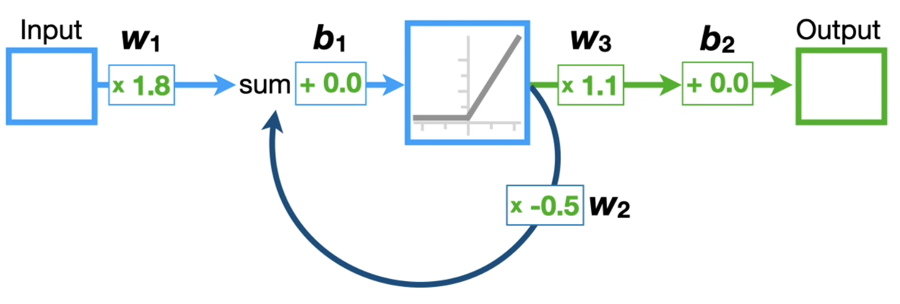
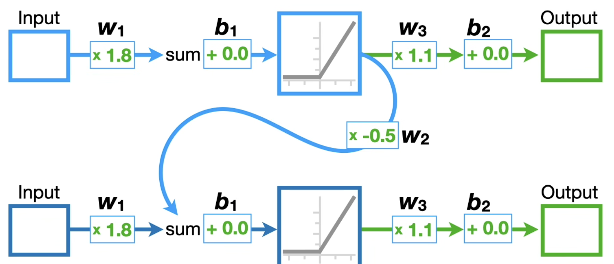

**Goals of understanding for homework 2:**

- LSTM layers
- GRU
- SGD for optization

#### Feedforward Neural Networks

Before we had RNNs we used feedforward neural networks. These networks included disadvantages:

- Slow to train over lots of data
- Considered limited context
- Fixed input size
- Lack of sequence modeling

We could use a window-based nueral model for FFN and consider a fixed-sized window as input to predict the next word in the sequence.

With this we have improvements:

- No sparsity problem
- Model size is smaller

And disadvantages:

- Fixed window is too small
- Enlarging window enlarges W
- Window can never be large enough
- Each input x uses different rows of W, and this can't hold as we don't share weights across windows
- We need a neural arch. that can process any length input

#### Recurrent Neural Networks (RNNs)

The **core idea** is that we apply the same weights W repeatedly.

Our NN needs to be flexiable in the amount of previous data is can see. For instance if we give it 4 words or 10 words it should be able to predict another token regardless of input length.

A RNN may look like it's only taking in one single value, but the main arch. difference from previous NNs is that there is a feed back loop as seen above.

When we input sequential data into the input here we may find it difficult to understand what is being processed currently in the loop. To view this better we can **unroll** the network with a copy of it and ignore out first output as seen below:

With this unrolling we have a network that can handle 2 inputs and 2 outputs. With a simple stock price example, the first input could be yesterday's stock price and the second could be today's stock price while the first output could be today's stock price and the second tomorrow's stock price.

If we have more inputs, we just keep unrolling the network.

_Note:_ Regardless of how many times we unroll our network, the weights and biases are shared across every input.

**Why are basic RNNs not used very often?**

- The more we unroll a RNN, the harder it is to train --> This is known as the vanishing/exploading gradient problem. Focus on the weight on the squiggle upon the loop we keep duplicating.
- We can have an exploding gradient if our weight is larger than 1 for every loop this makes the weight grow larger and larger and larger and we can't find an optimal minimum because our huge step keeps bouncing around everywhere. We can fix this by limiting our weight to values less than 1 but this can cause:
- The vanishing gradient. Here we have to constantly minimize a loss function which can lead our weight going to a very small steps and we'll never reach our optimal minmal.
- Well damn, can we get around this at all? Yes my sweet supple child, we will explore a better RNN called Long Short-Term Memory NNs (LSTMs)...

#### Long Short-Term Memory NNs (LSTMs)

The **main idea** of how LSTMs work is that it uses two paths to get to the output. 1 for long term memories and another for short term memories.

Before continuing please familiarize yourself with the Sigmoid and Tanh activation functions in /Knowledge_Map/Computer_Science/Artificial_Intelligence/activationFunctions.md

Unfortunately this new arch. is much more complicated than duplicating simple networks with a loop.
