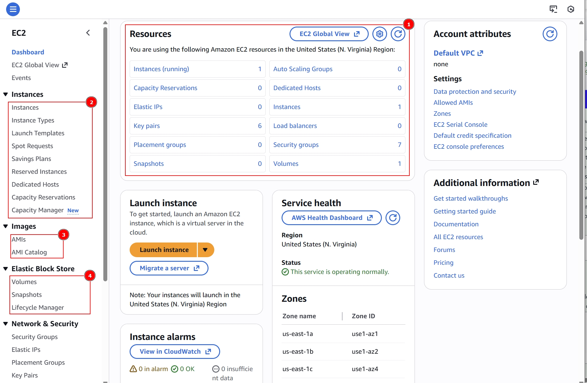

**Servers** in the Cloud:

- Servers have allowed us to scale capacity
- Added storage, more memory, and computing power
- No need for onsite hardware or capital expenses

**Elastic Cloud Compute (EC2):**

- A service that provides servers for rent in the cloud
- There are different pricing options for EC2:
  - On Demand: Pay as you go, no contract.
  - Dedicated Hosts: You have your own dedicated hardware and don't share it with others.
  - Spot: You pay the current Spot price, which fluctuates based on supply and demand. If the Spot price exceeds your maximum price or capacity is no longer available, your instance is interrupted.
  - Reserved Instances: You earn huge discounts if you pay up front and sign a 1-year or 3-year contract.

_Example of EC2 DashBoard Information:_

1. Resources: A summary of all the EC2 resources running in a particular region such as instances, elastic IPs, placement groups, ...
2. Instances: Shows the list and details of the instances running in a given region
3. Images aka AMIs: Images are pre-configured templates containing an OS, application server, and software required to launch a virtual server. We can create custom AMIs, or we can use images owned by Amazon or others. We can use EC2 Image Builder for custom jobs.
4. Elastic Block Store (EBS): Simply put, EBS is an external hard drive that we can attach to the server for additional storage. In the section we have **volumes**, **snapshots**, and the **lifescycle manager**.
5. Network and Security:

- **Security Groups** - acts as firewall rules that control traffic for EC2 instances or VPCs.
- **Elastic IP Addresses** - static IPv4 address. In case you have a EC2 server instance failure the backup instance will spin up.
- **Placement Group** - The EC2 instances are like VMs running on real servers in a data cetner and you can place them with different strategies like _clustered_, _partitioned_, and _spread evenly_.
- **Key Pairs** - Our instances have public and private keys.
- **Network Interfaces** - A network interface represents a virtual network card in a VPC

6. **Load Balancing** - Distributes incoming traffic across multiple servers (or targets such as EC2 instances). There are 3 types of load balancers: _Application Load Balancers_, _Network Load Balancers_, _Classic Load Balancers_.
7. **EC2 Auto Scaling**: A service that automatically launches/terminates EC2 instances based on user-defined scaling policies.

#### AWS Command Line Interface

Allows you to access and control services running in your AWS account from the command line.

- You could install it and configure it on your own shell
- Or you could use the browser version: AWS CloudShell

#### Creating a EC2 Instance

You simply can launch the instance wizard and configure all the settings you need. Then you can connect to the instance.

#### Elastic Block Store (EBS)

EBS is a block-level storage service for EC2 instances that provides storage volumes that are attached to the EC2 instance to increase storage.

Simply put, EBS is an external hard drive that we can attach to the server for additional storage.

Benefits of using EBS are:

- Data persists after instances are terminated
- Automatically replicated within its avaliablity zone
