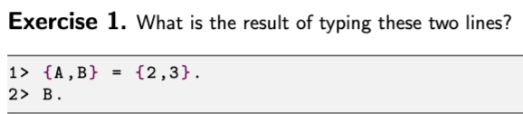
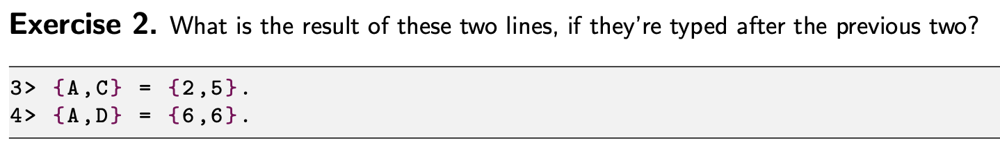
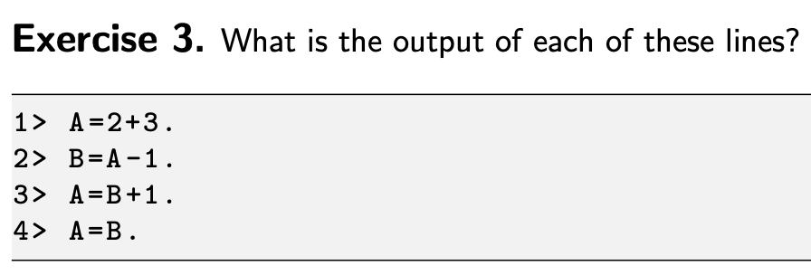
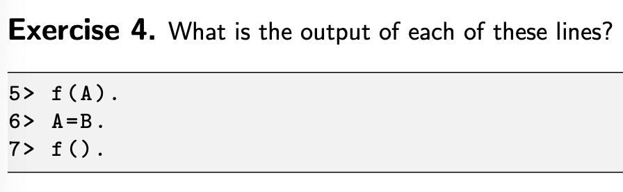
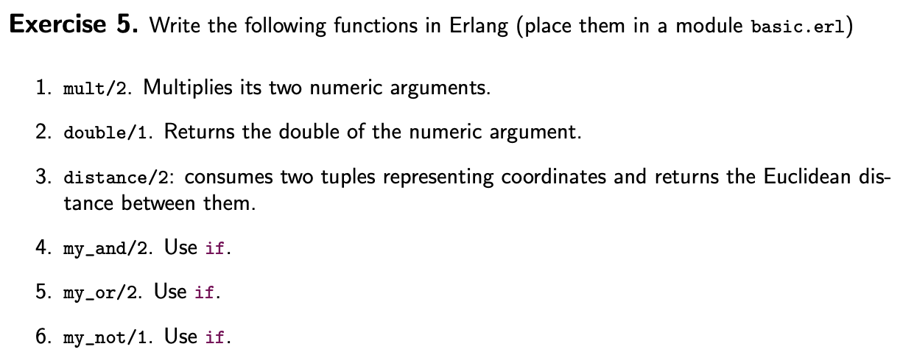
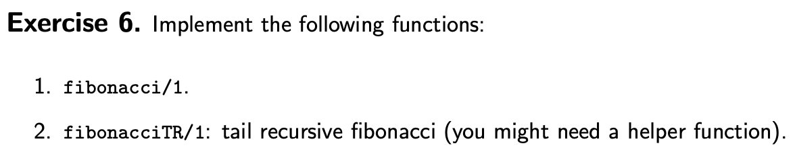
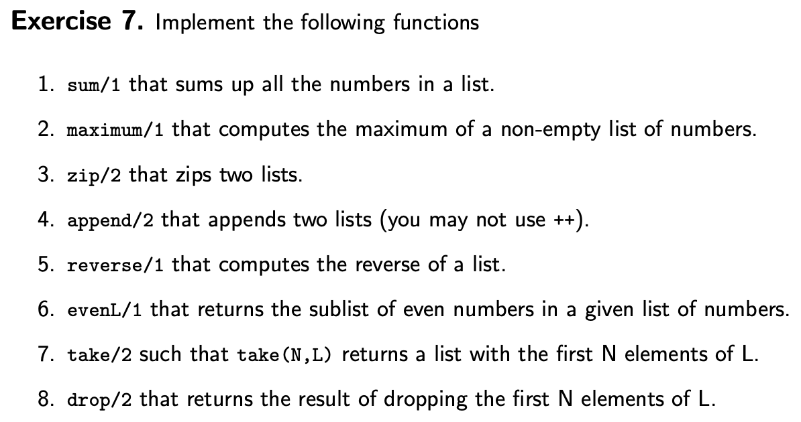

# Erlang Recap Problem Set

## Exercises:

This creates a tuple for A and B and assigns values to the respective variables. B would then output 3.

There is no result because tuples can not be altered. That was my initial thought, but apprently it causes an exception error: no match of right hand side value {6,6}.

1 --> 5
2 --> 4
3 --> 5
4 --> exception error: no match of right hand side value 4 ; maybe this is basically like a false... Well not actually because == is an operator.

f(A) --> ok
A=B --> ?? B was never defined tho
f() --> ok
... idk

1:

mult(X,Y) -> X \* Y.

2:

double(X) -> X \* 2.

3:

See eb1.erl

Idk what .4, .5 & .6 are asking.

1:

See eb1.erl

