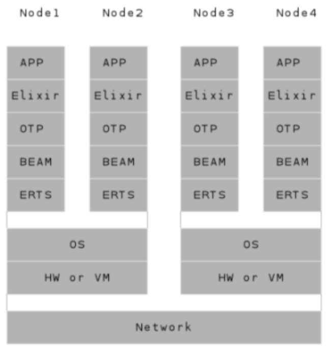

#### Introduction

Previously, we have looked at concurrent tools such as semaphores and monitors.

So aren't we done with concurrent programming? Haven't we solved it?

Well, the problem with monitors is that they are:

- Highly centralized (un/blocking processes, maintaining queues, encapsulating data...)
- And for modern, distributed architectures, there is a need for a less centralized solution

#### Erlang's Concurrency System

Erland consists of a number of distributed Erlang runtime systems communicating with each other (instances of the VM) ; Each such system is called a **node:**



This diagram shows multiple Erlang runtime systems connected through a network. Each runtime system is called a node and each node runs the Erlang virtual machine and can contain many concurrent Erlang processes.

The _erl_ command starts an Erlang runtime system. While a **node** is an executing Erlang runtime system that has been given a name.

- We can find the name of a node using:

1> **node().**
nonode@nohost

For the purposes of our concurrent course we will work within a unique Erlang runtime system, without assigning it a name.

#### Processes and Communication in Erlang

A **process** is a node that has:

- a process id (pid)
- we can grab pid with:
  1> **self().**
  <0.78.0>
- its own memory (a mailbox, a heap and a stack)
- a process control block (PCB) with information about the process

Format of **PID**:

- node id where process lives; 0 if node is local
- process index itself (index to the process table)
- serial which increases every time MAXPROCS has been reached

The **Message passing Model**:

There is no shared memory, a process sends a message and another process recieves the message.

There are two main operations:

1. PID ! msg - This sends a message (msg) to the process identified by Pid ; non-blocking it sneds msg to Pid
2. recieve pattern -> action end - This waits for and process a message matching "pattern" ; recieve blocks until a message is avaliable in the mailbox

For instance, process A can send hello to process B without waiting for B to read it. The message stays in B's mailbox until B recieves it.

A **simple echo server**:

We can create a process, echo, that returns whatever message is recieved, after that it will continue to wait for a new message. It may be stopped by sending it the _stop_ message:

```erlang
echo() ->
    receive % waits for a message
        {From, Msg} -> % recieves {From, Msg} which extracts the sender's PID and the message
            From ! {Msg}, % replies using From ! {Msg}
            echo(); % calls echo() again to continue processing messages (this part is the recursion)
        stop -> % if we recieve a stop we terminate
            true
    end.
```

We can _run_ the echo server using a start() function:

We have two processes communicating with eachother below. Process A (the caller) which executes start() and Process B (the echo server) created by spawn and executes echo()

```erlang
start() ->
    Pid = spawn(fun echo/0), % creates a new process running echo() and returns it's pid
    Token = "Hello Server!", % The string we can send
    Pid ! {self(), Token}, % The calling process then sends the message. We use self() because the echo server needs to know hwere to send the response
    % We are not sending the message to the thread we just created, we are sending it to the thread that just called start()
    receive % the caller then waits
        {Msg} ->
            io:format("Received ~s~n", [Msg])
    end,
    Pid ! stop. % then we stop the server
```

**Reacting to Multiple Messages:**

Erlang listens for messages from different senders. In which order will they be processed? Can we force an order? A recieve statement tries to find a match as early in the mailbox as it can. Here we are introducing the erlang concept: **selective recieve**.

Let's take a look at the example:

```erlang
recieve
  msg3 -> 42
end
```

A process mailbox can check for "msg3" and remove it from the stack and then return 42.

Sources can come from multiple sources. How do we know who sent a message? We can distinguish the source by the Pids. Let's take another look at start():

```erlang
start() ->
    PidB = spawn(fun echo/0),
    PidC = spawn(fun echo/0),

    Token = 42,
    PidB ! {self(), Token},

    Token2 = 41,
    PidC ! {self(), Token2}

    receive
        ... % match the messages by sender
    end,
    PidB ! stop,
    PidC ! stop,
```

And in our echo server we'll have _From ! {Msg}_,* turn into *From ! {self(), Msg}\* to know who sent what!

But silly billy, what if our messages come from just one source??? Well we can use _make_ref_ which is like a request ID. When the response arrives its reference tells you which request it belongs to. Now our ! command expects this extra field. (slide 21)

We can also have **guards** or conditions on our recieves. (slide 24)

We can have **timeouts** on recieves that take too long. (slide 25)

#### Semaphore Exercise
