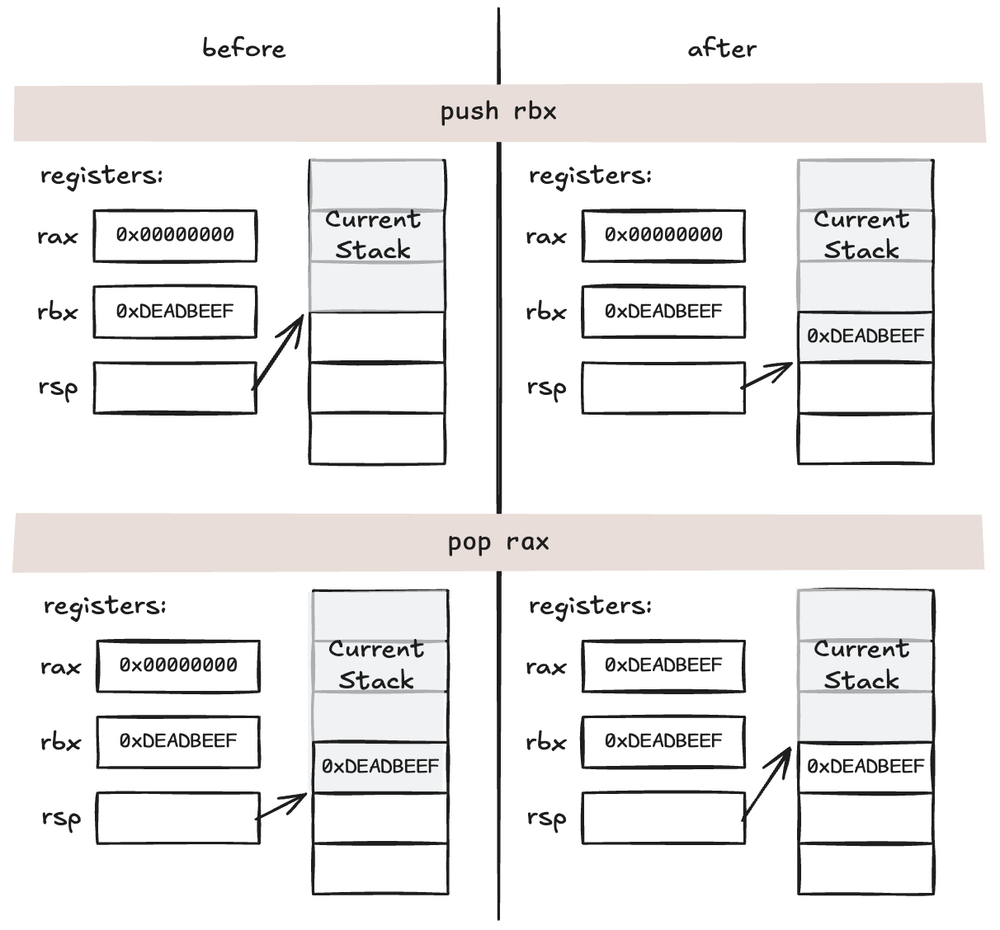

# Assembly Recap for Security

## Introduction

Assembly is a low-level programming language where instructions correspond closely to operations executed by the CPU. 

We will be looking at x86_64 assembly. 

It is similar to ARM but has some quirks due to its history. 

Unlike higher level programming languages, we don't work with named variables such as x or y. Instead we work with registers and memory. 

## Registers

Registers are tiny, extremely fast storage locations inside the CPU. 

Important registers: 
- Name : Common Purpose 
- rax  : arithmetic, return values
- rbx  : general-purpose storage 
- rcx  : counters, general-purpose 
- rdx  : arithmetic, general-purpose
- rsi  : source pointer, second argument 
- rdi  : destination pointer, first argument 
- rsp  : stack pointer 
- rbp  : stack frame base pointer 
- rip  : instruction pointer 

Each of these registers is 64 bits wide 

Registers rdi through r9 are commonly used to **pass arguments** to functions. 

The order goes like: 
- rdi
- rsi 
- rdx 
- rcx 
- r8
- r9 
- And the rest are stored on the stack 

## Assembly Instructions

The format of instructions are: 
(instruction) (destination), (source)

- Instruction : Meaning : Example 
- mov : copy data : mov rax, 5 
- add : addition : add rax, 3 

## The Stack

The stack is a region of memory commonly used for function calls, local variables, and temporarily saving data 

The two fundamental instructions are: 
- push : place a value onto the stack 
- pop : remove a value from the top of the stack 

Ex: 

```asm 
mov rax, 10 ; copy 10 into rax 
push rax ; pushed rax value to top of stack 
mov rax, 20 ; copy 20 into rax 
pop rax ; remove 10 from top of stack 
```

Example image: 



