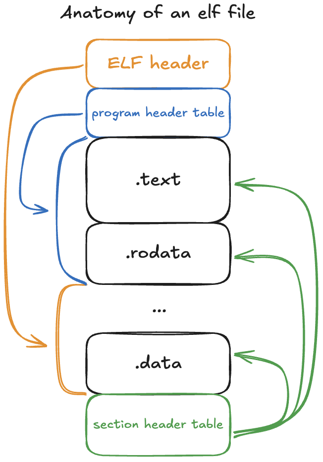
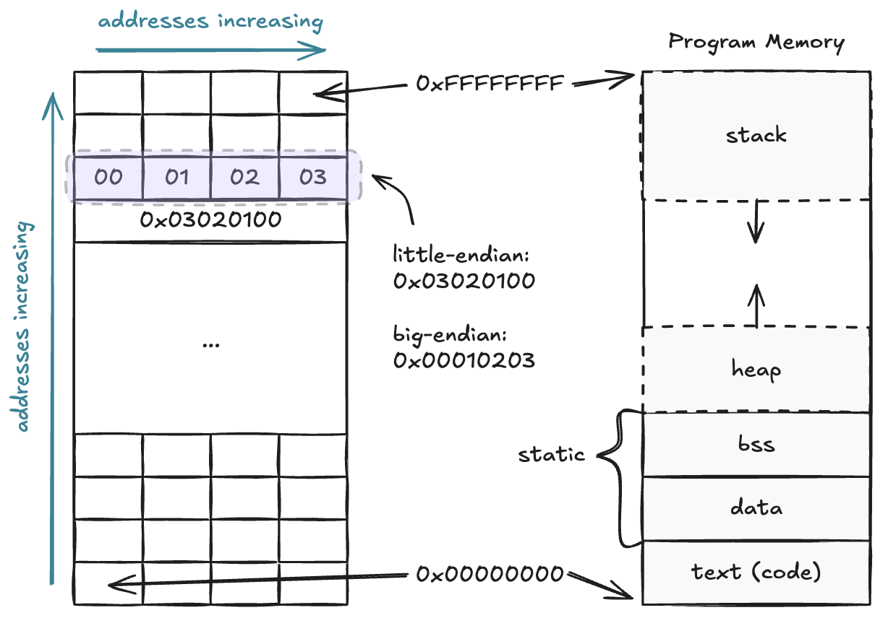
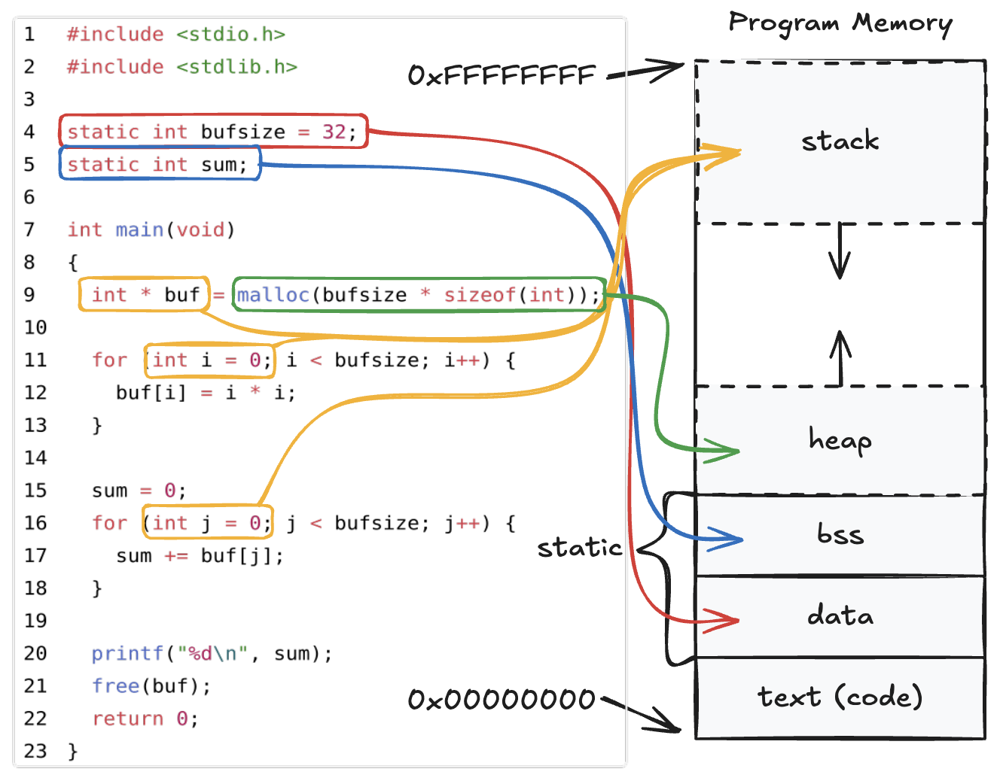
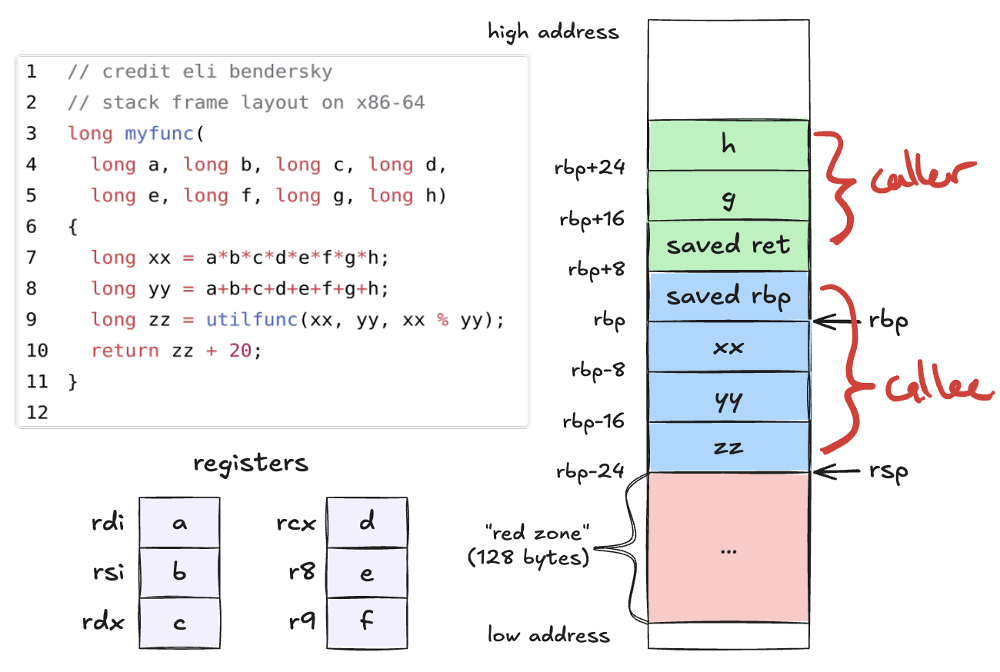
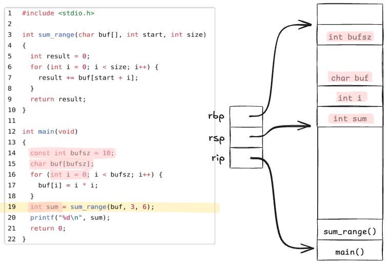
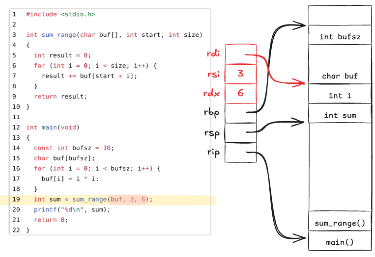
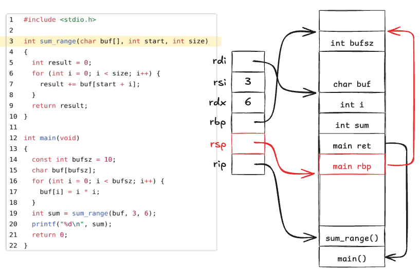

#### C Programs

To go from a C program to execution:

1. **Compiler** translates C to assembly
2. **Assembler** translates assembly to machine code objects
3. **Linker** combines objects and libraries into an executable
4. **Loader** initialized

The **instruction set architecture** determines the machine code. Examples include x86, ARM, etc. Different ISAs define which machine instructions a processor can execute, how it accesses memory and how it performs computations. Note: RISC and CISC are processor architecture design philosophies not actual ISAs.

The **operating system** determines the executable format, libraries, avaliable syscalls, etc.

In CS 396 we will be using 64-bit x86 (aka x86_64) and Linux.

#### Executable and Linkable Format (ELF)

Linux uses ELF binary files for executables.

The anatomy of an ELF file:

An ELF file is organized as follows:

ELF Header: Holds metadata and pointers to entry, program header table, and section header table.

Program Header Table: Groups code and data into loadable segments that loader refers to during process initialization.

Section Header Table: Groups code and data into linkable sections that linker needs when construction executables.

[Insert Linux executable walkthrough]

#### Program Memory

Sections:

- **Stack:** local variables (function scope)
- **Heap:** dynamically allocated memory
- **BSS:** unitialized global data (global static) - like global and static variables that are uninitialized or initialized to zero
- **Data:** initialized global data (global static)
- **Text:** program code

Let's look at an example of where certain things are located in program memory below!

- We have our headers at the top
- Then we initialize a global variable bufsize which means its in data
- Then we have an uninitialized global variable sum which means its in bss
- Then we have our main
- Inisde our main we have a dynamically allocated buf pointer
- buf is local so that pointer is on the stack, but what its pointing too (the malloc) is located on the heap
- And other variables such as j are local and on the stack
- Then of course the code itself is in text

#### Stack Frame

During execution, each function gets its own stack frame which contains:

- passed arguments
- local variables
- return address
- caller's base address

The exact format of the stack frame depends on the system's calling convention.

Note: There is an epilogue and prologue when we call functions and below our prologue is pushing the base pregister to the stack (frame pointer rbp) ; the epilogue is ... 

Let's take a look at an example of a stack frame:

So the whole vertical rectangle on the right represents our stack frame.

The code on the left is some C code. Let's map out what we have in the code!

- We have a function called myfunc()
- This function takes 8 areguments a-h
- It has 3 local variables: xx, yy, zz
- It calls another function utilfunc()
- It has a return value

Now let's take a look at the memory.

Where do the eight arguments go?

- The first arguments go into the registers rdi, rsi, rdx, rcx, r8, r9 and the rest go onto the stack at rbp+16 and rbp+24
- Why are they on rbp?

Understanding rbp and rsp

- rbp is the stack frame base pointer
- rsp is the stack pointer which points to the current top of the stack which in this case is growing down

What is the green section?

- The green section shows the 2 additional arguments and the return address
- The return address is the address of the instruction the CPU should execute after myfunc() is done
- the return address is not the return value of the function

What is the blue section?

- This holds the local variables of the funtion and the saved stack frame base pointer

Still a bit confused? Don't worry lets get into another more dynamic example...

#### Stack Frame Ex 2

We have some code here that sums a range.

Step 1: Before sum_range() is called lets take a look at what we have on the stack!

- rip (instruction poiner) is currently going through main and is connected to main() with sum_range() right above it
- rsp (stack pointer) is above all the other local variables defined before it as it is growing down
  - Above rsp we have defined our sum, i, buf, and bufsz
- rbp (stack frame base pointer) is at the top as we are about to call our function and use a stack frame

Step 2: Load arguments

Our first arguments are stored in rdi, rsi, and rdx.

- rdi is an address pointing to buf and rsi and rdx holds numbers

Step 3: Save return address and call sum_range()

Here we move our stack pointer up 1 and we have the return address to get back to main after we jummp to sum_range()

We also move our instruction pointer (rsi) to sum_range()

And we save the frame base pointer that the stack had with rsp.

...
