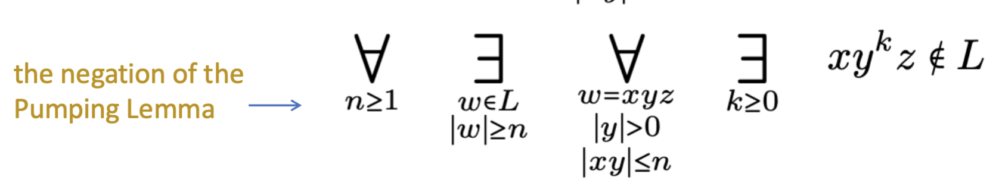
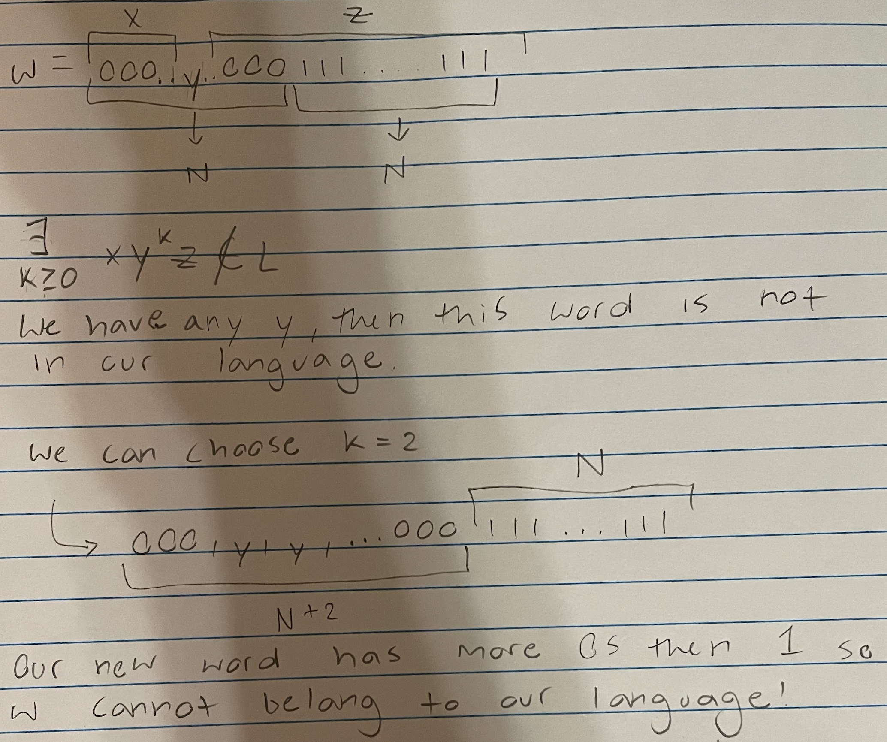

#### Pumping Lemma Definition

The pumping lemma allows us to check if a language NOT regular. However, proving the pumping lemma on a language does not guarentee that a language IS regular.

We can show a language is regular by negating the Pumping Lemma using the quantifiers below:

This negation says:

No matter what threshold you take (that is the n), there will actually be no threshold, this langauge will not be good. This threshold will not be good because we can find a word that does not have the "good" generator. For every possible good generator y in the 3rd quantifier that generator will turn out to give us a word that does not belong to our language.

#### Pumping Lemma Examples

Each of these quantifiers is going to be a step to get to the end of our proof.

##### Ex 1

Use the pumping lemma to show that L = {0^k 1^k | k >= 1} is NOT regular

Step 1:

We do the first quantifier. We pick an arbitrary N >= 1. Boom done.

Step 2:

We have to pick a word from the language where the length is greater than our N.

Let's choose w = 0^N 1^N

Step 3:

Alright so let w now equal xyz. Our |y| is > 0 and our |xy| is <= N

Step 4:

Now we can look at this generator y and see that with it our word no longer is apart of the language L!

#### Ex 2
